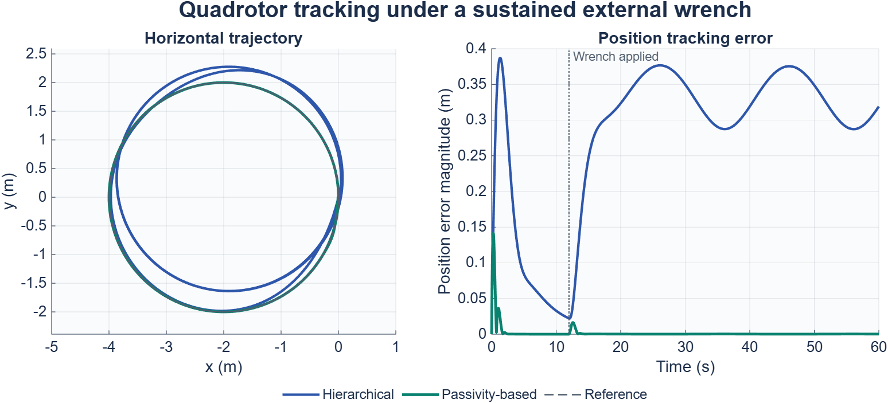

# Trajectory Tracking for Quadrotors under External Wrenches

**Hierarchical vs. Passivity-Based Control**

A MATLAB and Simulink comparison of two quadrotor controllers on a 60-second circular reference that climbs to 1 m and then holds altitude. The disturbed scenario applies a sustained horizontal force of `[0.4, 0.6, 0] N` and a yaw torque of `0.3 N·m` at 12 s.

[Technical report](quadrotor-trajectory-tracking-under-external-wrenches.pdf)



## Control architectures

The two Simulink implementations were developed and compared for Field and Service Robotics at the University of Naples Federico II, supervised by Prof. Fabio Ruggiero.

| Controller | Implementation |
| --- | --- |
| [Hierarchical](Hierarchical/) | Outer-loop LQR for position, inner-loop PD for attitude, and a rotor and motor model. |
| [Passivity-based](Passivity-Based/) | Cascaded position and attitude control with a momentum-based observer for external forces and torques. |

## Results

Position RMSE is the root mean square of the 3D tracking-error magnitude over 12–60 s. The same time window is used for each run.

| Scenario | Hierarchical | Passivity-based |
| --- | ---: | ---: |
| Nominal | 0.00556 m | 0.00000234 m |
| External wrench | 0.322 m | 0.00177 m |

Both controllers track the nominal reference closely. With the applied wrench, hierarchical control shows a persistent lateral offset. The passivity-based controller recovers the reference after a brief transient in this simulation.

## Run the simulations

Tested with MATLAB R2026a, Simulink, Control System Toolbox, Signal Processing Toolbox, and UAV Toolbox.

Set MATLAB's current folder to the repository root and run one of the following commands.

```matlab
run('Hierarchical/main.m')                         % Hierarchical, nominal
run('Hierarchical/main_wrench.m')                  % Hierarchical, external wrench
run('Passivity-Based/MainPassivityNoDisturbance.m') % Passivity-based, nominal
run('Passivity-Based/MainPassivityDisturbance.m')   % Passivity-based, external wrench
```

The scripts generate their MATLAB input data, run the models, and export position, attitude, and thrust plots as EPS files. Hierarchical runs write to `Hierarchical/figures/`. Passivity-based runs write to `Passivity-Based/PassivityNoDisturbance/` or `Passivity-Based/PassivityDisturbance/`.

On Windows, a deeply nested checkout can exceed the build path limit. If Simulink reports this error, use a shorter checkout path or run the following in the current MATLAB session before starting a simulation. [MathWorks documentation](https://www.mathworks.com/help/simulink/slref/simulink.filegencontrol.html)

```matlab
buildFolder = tempname;
Simulink.fileGenControl('set', 'CacheFolder', buildFolder, ...
    'CodeGenFolder', buildFolder, 'createDir', true);
```
